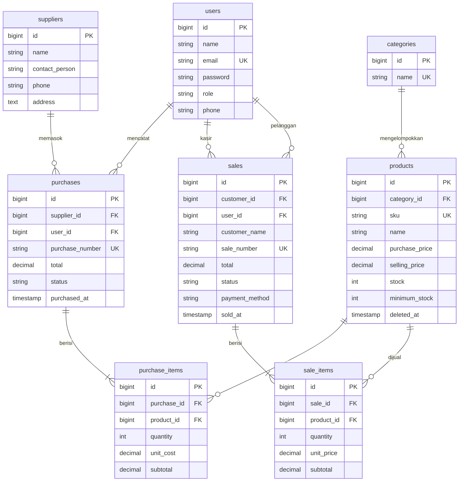

# Apotek MedikaCare

**Sistem Informasi Stok dan Penjualan Apotek (Inventory & Sales Management System)**

Proyek UTS Web Programming — Integrated Laravel Project.

Nama: **Intan Mandalika**  
NIM: **250180005**  
Kelas: **A1**

---

## 1. Project Overview

Apotek MedikaCare melayani penjualan eceran melalui kasir dan pemesanan dari pelanggan melalui website. Sistem ini dikembangkan untuk membantu mengatasi masalah pencatatan manual dan meningkatkan konsistensi data transaksi serta stok apotek.

| Masalah | Solusi di Sistem |
|---|---|
| Stok tidak berkurang sesuai jumlah barang yang terjual | Stok dan pencatatan transaksi diproses dalam satu `DB::transaction`. |
| Produk yang habis masih bisa dijual | Stok diperiksa dan baris produk dikunci menggunakan `lockForUpdate` sebelum stok dikurangi. |
| Riwayat penjualan sulit ditelusuri | Transaksi memiliki nomor unik, pencatat, dan waktu transaksi. |
| Pemilik dan staf membutuhkan hak akses berbeda | Peran Admin, Staff, dan Pelanggan dibatasi melalui middleware di server. |
| Pemilik membutuhkan ringkasan penjualan | Dashboard dan laporan penjualan harian, mingguan, dan bulanan yang dapat dicetak. |
| Stok menipis tidak diketahui | Sistem menyediakan stok minimum per produk dan daftar stok rendah. |

### Teknologi yang Digunakan

- Laravel 12
- PHP 8.2
- MySQL
- Eloquent ORM
- Blade
- Bootstrap 5
- Bootstrap Icons
- Chart.js

Bootstrap, Bootstrap Icons, font, dan Chart.js dimuat melalui CDN.

## 2. Requirements

- PHP 8.2 atau lebih baru, dengan ekstensi yang diperlukan Laravel, termasuk `mbstring`, `openssl`, `pdo_mysql`, `fileinfo`, `ctype`, `json`, `tokenizer`, dan `xml`.
- Ekstensi `pdo_sqlite` untuk menjalankan pengujian.
- Composer 2.
- MySQL 8 atau MariaDB 10.4 ke atas, misalnya melalui XAMPP.
- Git.
- Koneksi internet untuk memuat aset melalui CDN.

Node.js dan npm tidak diperlukan untuk alur pengembangan yang menggunakan aset CDN ini.

## 3. Installation

Clone repository menggunakan URL GitHub proyek yang sebenarnya.

```bash
git clone <URL-REPOSITORY> medikacare
cd medikacare
composer install
```

## 4. Environment Setup

Salin file environment contoh dan buat kunci aplikasi.

Windows:

```powershell
copy .env.example .env
php artisan key:generate
```

macOS atau Linux:

```bash
cp .env.example .env
php artisan key:generate
```

Sesuaikan konfigurasi database dalam file `.env`:

```env
DB_CONNECTION=mysql
DB_HOST=127.0.0.1
DB_PORT=3306
DB_DATABASE=medikacare
DB_USERNAME=root
DB_PASSWORD=
```

Pengaturan bahasa aplikasi:

```env
APP_LOCALE=id
APP_FALLBACK_LOCALE=en
```

Buat database kosong bernama `medikacare` melalui phpMyAdmin dengan collation `utf8mb4_unicode_ci`, atau melalui terminal:

```bash
mysql -u root -e "CREATE DATABASE medikacare CHARACTER SET utf8mb4 COLLATE utf8mb4_unicode_ci;"
```

Sesuaikan nama pengguna dan kata sandi MySQL dengan konfigurasi lokal.

File `.env` tidak disertakan dalam repository. Repository hanya menyediakan `.env.example` sebagai contoh konfigurasi.

## 5. Migration & Seeding

Jalankan migration dan seeder:

```bash
php artisan migrate --seed
```

Kemudian jalankan aplikasi:

```bash
php artisan serve
```

Buka `http://127.0.0.1:8000` melalui browser.

Seeder proyek menyediakan data demo berupa:

- 5 akun pengguna.
- 4 kategori produk.
- 3 supplier.
- 21 produk yang mencakup obat bebas, obat keras, vitamin, dan alat kesehatan.

Data yang digunakan untuk demo bersifat fiktif.

Untuk membuat ulang database dan menjalankan seeder dari awal:

```bash
php artisan migrate:fresh --seed
```

**Perhatian:** `migrate:fresh` menghapus tabel yang ada dalam database sebelum membuatnya kembali. Gunakan hanya jika memang ingin mengulang database dari awal.

## 6. Demo Account

Semua akun demo menggunakan password `password123`.

| Peran | Nama | Email |
|---|---|---|
| Admin | Rina Kartika | `admin@medikacare.test` |
| Staff | Budi Santoso | `staff1@medikacare.test` |
| Staff | Sari Wulandari | `staff2@medikacare.test` |
| Pelanggan | Ahmad Fauzi | `pelanggan@medikacare.test` |
| Pelanggan | Klinik Pratama Sehat Sentosa | `klinik@medikacare.test` |

Pada halaman login dalam mode lokal, tersedia tombol pintas Admin, Staff, dan Pelanggan yang mengisi email serta password secara otomatis.

Akun dan password tersebut ditujukan untuk pengujian lokal, bukan penggunaan produksi.

## 7. Features

### 7.1. Admin / Owner

- Mengelola pengguna: tambah, ubah, dan hapus.
- Admin tidak dapat menghapus atau menurunkan peran akunnya sendiri.
- Akun yang sudah memiliki riwayat transaksi tidak dapat dihapus.
- CRUD kategori, produk, dan supplier.
- SKU produk harus unik.
- Produk menggunakan soft delete.
- Melihat seluruh transaksi pembelian dan penjualan.
- Dashboard berisi penjualan hari ini dan bulan ini, jumlah transaksi, jumlah produk, stok rendah, grafik penjualan tujuh hari, dan grafik stok per kategori.
- Laporan penjualan harian, mingguan, dan bulanan.
- Filter laporan berdasarkan kasir dan fitur cetak A4.
- Pembatalan pembelian dengan pemeriksaan stok yang sudah digunakan.
- Pembatalan penjualan selesai paling lama 24 jam sesuai aturan koreksi transaksi.

### 7.2. Staff

- Melihat data produk dan daftar stok rendah.
- Mencatat pembelian barang dari supplier dengan banyak item dalam satu transaksi.
- Mencatat penjualan langsung melalui kasir.
- Mencetak struk penjualan.
- Mengonfirmasi atau menolak pesanan pelanggan.
- Melihat transaksi yang dicatat sendiri serta pesanan pelanggan yang menunggu konfirmasi.

### 7.3. Pelanggan

- Melihat katalog tanpa harus login.
- Melihat nama, kategori, harga jual, dan status stok produk.
- Harga beli tidak dikirim ke halaman katalog.
- Mendaftar akun dan menggunakan keranjang belanja.
- Membuat pesanan dengan pilihan bayar di toko atau transfer.
- Memantau status pesanan.
- Membatalkan pesanan yang belum dikonfirmasi.
- Melihat detail pesanan dan informasi pembayaran.
- Mencetak struk setelah pesanan selesai.

### 7.4. Tampilan dan Detail Pembayaran

Selain fitur inti, tampilan beberapa halaman disesuaikan untuk membuat informasi lebih mudah dibaca.

- Halaman detail pelanggan dipercantik agar penyajian informasi lebih rapi.
- Halaman detail pesanan menyediakan petunjuk pembayaran sesuai metode yang dipilih.
- Informasi transfer mencakup rekening contoh, nominal transfer, dan nomor transaksi sebagai catatan transfer.
- Tombol salin membantu pengguna menyalin informasi pembayaran yang tersedia.
- Halaman detail penjualan menampilkan informasi transaksi dan menyediakan tombol cetak struk.
- Styling khusus disimpan dalam `public/css/medikacare.css`.
- Layout halaman guest disesuaikan melalui `resources/views/layouts/guest.blade.php`.

Informasi rekening merupakan data contoh untuk demonstrasi. Pembayaran transfer diperiksa dan dikonfirmasi secara manual oleh staf.

### 7.5. Alur Pesanan Pelanggan

1. Pelanggan membuat pesanan. Status awal **Menunggu** dan stok belum dikurangi.
2. Pelanggan memilih metode bayar di toko atau transfer.
3. Untuk transfer, pelanggan mengikuti petunjuk pembayaran dan melakukan transfer ke rekening contoh.
4. Staf memeriksa pembayaran dan mengonfirmasi pesanan.
5. Saat konfirmasi, stok diperiksa kembali dan dikurangi jika mencukupi. Pesanan menjadi **Selesai** dan struk dapat dicetak.
6. Jika stok tidak mencukupi saat konfirmasi, proses konfirmasi ditolak dan pesanan tetap menunggu.

Konfirmasi pembayaran transfer dilakukan manual. Aplikasi tidak menggunakan payment gateway atau verifikasi transfer otomatis.

### 7.6. Aturan Bisnis dan Integritas Data

- SKU produk unik melalui validasi form dan unique index database.
- Jumlah transaksi harus lebih dari nol.
- Harga tidak boleh negatif.
- Harga jual tidak boleh lebih rendah daripada harga beli.
- Penjualan tidak boleh melebihi stok tersedia.
- Produk dikunci selama proses transaksi yang memerlukan penguncian, dengan urutan yang konsisten untuk membantu mencegah deadlock.
- Stok hanya berubah ketika transaksi terkait berhasil.
- Penjualan kasir mengurangi stok saat transaksi disimpan.
- Pesanan pelanggan mengurangi stok saat pesanan dikonfirmasi.
- Total transaksi dan harga dihitung di server; harga yang dikirim dari browser tidak dipercaya.
- Harga satuan disimpan pada item transaksi agar struk historis tidak berubah ketika harga produk diperbarui.
- Header transaksi, item, dan perubahan stok yang terkait diproses dalam satu `DB::transaction`.
- Jika proses transaksi gagal, perubahan yang berada dalam transaksi database dibatalkan.
- Transaksi selesai tidak diedit langsung; koreksi mengikuti aturan pembatalan yang berlaku.
- Produk yang telah digunakan dalam transaksi tidak dihapus permanen.
- Hak akses dijaga di server melalui middleware `role`.
- Aplikasi menggunakan proteksi CSRF, escaping output, password hashing, dan validasi server.
- Daftar data menggunakan pagination: 10 baris per halaman dan 12 produk per halaman katalog.
- Filter pencarian dipertahankan ketika berpindah halaman.

## 8. Known Limitations

- Pembayaran transfer diperiksa dan dikonfirmasi manual oleh staf.
- Tidak ada payment gateway, verifikasi transfer otomatis, atau unggah bukti transfer.
- Rekening pembayaran yang ditampilkan adalah rekening contoh untuk demo.
- Setiap produk hanya memiliki satu harga jual; harga grosir belum tersedia.
- Sistem menggunakan satu gudang.
- Belum ada pencatatan tanggal kedaluwarsa obat dan retur barang.
- Barang yang sudah dibeli tidak dapat dikembalikan melalui fitur retur.
- Keranjang disimpan di sesi browser dan dapat hilang ketika sesi berakhir.
- Pesanan yang menunggu konfirmasi tidak mereservasi stok.
- Bootstrap, ikon, font, dan Chart.js dimuat melalui CDN sehingga memerlukan koneksi internet.
- Fitur lupa password belum tersedia.
- Laporan cetak dibatasi maksimal 500 transaksi per proses cetak.

## 9. ERD dan Relasi

Diagram ERD berikut mendokumentasikan entitas utama yang digunakan dalam sistem.



### Relasi Eloquent

| Model | Relasi |
|---|---|
| Category | `hasMany` Product |
| Product | `belongsTo` Category, `hasMany` SaleItem, `hasMany` PurchaseItem |
| Supplier | `hasMany` Purchase |
| Purchase | `belongsTo` Supplier, `belongsTo` User, `hasMany` PurchaseItem |
| PurchaseItem | `belongsTo` Purchase, `belongsTo` Product |
| Sale | `belongsTo` User sebagai kasir, `belongsTo` User sebagai pelanggan melalui `customer_id`, `hasMany` SaleItem |
| SaleItem | `belongsTo` Sale, `belongsTo` Product |
| User | `hasMany` Sale sebagai kasir dan sebagai pelanggan |

`hasMany` dipasang pada sisi induk yang dapat memiliki banyak data terkait. `belongsTo` digunakan pada sisi yang menyimpan foreign key untuk menunjuk induknya.

**Catatan:** nama foreign key, kardinalitas, dan nama kolom ERD perlu sesuai dengan migration serta relasi model aktual.

## 10. Struktur Kode dan Alur Request

Alur umum permintaan aplikasi:

```text
Browser
  -> Route (routes/web.php)
  -> Middleware (auth, role)
  -> Controller
  -> Validasi
  -> DB::transaction
  -> Model Eloquent
  -> MySQL
  -> Blade View
  -> Browser
```

| Lokasi | Isi |
|---|---|
| `routes/web.php` | Rute aplikasi yang dikelompokkan berdasarkan peran |
| `app/Http/Middleware/RoleMiddleware.php` | Pemeriksaan hak akses di server |
| `app/Http/Controllers/` | Controller autentikasi, dashboard, kategori, produk, supplier, pembelian, penjualan, toko, keranjang, pesanan, laporan, dan pengguna |
| `app/Models/` | Model dan relasi Eloquent |
| `database/migrations/` | Skema tabel database |
| `database/seeders/` | Data demo awal |
| `resources/views/layouts/` | Layout guest, aplikasi Admin/Staff, dan toko pelanggan |
| `resources/views/` | Tampilan halaman tiap modul |
| `public/css/medikacare.css` | Styling khusus MedikaCare |
| `tests/Feature/` | Pengujian fitur aplikasi |

Logika transaksi penting berada pada:

- `SaleController@store` dan `SaleController@confirm`: pemeriksaan stok, penguncian, pengurangan stok, dan rollback.
- `PurchaseController@store` dan `PurchaseController@cancel`: pencatatan stok masuk dan pembatalan pembelian.
- `CartController@checkout`: pembuatan pesanan pelanggan berstatus menunggu.

Nama method dan controller harus tetap mengikuti kode aktual yang ada pada repository.

## 11. Pengujian

Jalankan pengujian dengan:

```bash
php artisan test
```

Tes menggunakan database SQLite sementara di memori sesuai konfigurasi `phpunit.xml`, sehingga pengujian tidak menggunakan database MySQL utama. Ekstensi `pdo_sqlite` harus aktif di PHP.

Hasil pengujian yang telah dicatat selama pengembangan adalah **46 tests passed dengan 165 assertions**. Jalankan kembali pengujian setelah perubahan kode untuk memastikan hasil terbaru.

| Skenario | Berkas tes |
|---|---|
| Tamu tidak dapat membuka dashboard dan password salah ditolak | `AuthTest` |
| SKU duplikat dan harga negatif ditolak | `ProductTest` |
| Pembelian menambah stok sesuai kuantitas | `PurchaseTest` |
| Penjualan mengurangi stok sesuai kuantitas | `SaleTest` |
| Penjualan melebihi stok ditolak tanpa perubahan data | `SaleTest`, `OrderTest` |
| Kegagalan satu item membatalkan transaksi keseluruhan | `SaleTest`, `PurchaseTest` |
| Staff tidak dapat mengakses fungsi Admin | `AuthorizationTest` |
| Pencarian dan pagination menghasilkan data yang sesuai | `ProductTest` |

Tes tambahan mencakup alur pesanan pelanggan, aturan pembatalan, manajemen pengguna, dan laporan penjualan. Nama berkas tes di atas harus sesuai dengan berkas yang tersedia dalam direktori `tests/Feature`.

## 12. Screenshot

Screenshot berikut merupakan daftar dokumentasi yang perlu disiapkan dari aplikasi MedikaCare yang dijalankan.

1. Login — `docs/screenshots/01-login.png`
2. Dashboard Admin — `docs/screenshots/02-dashboard-admin.png`
3. Daftar produk — `docs/screenshots/03-produk.png`
4. Pembelian baru — `docs/screenshots/04-pembelian-baru.png`
5. Penjualan baru — `docs/screenshots/05-penjualan-baru.png`
6. Struk — `docs/screenshots/06-struk.png`
7. Katalog pelanggan — `docs/screenshots/07-katalog.png`
8. Keranjang — `docs/screenshots/08-keranjang.png`
9. Detail pesanan — `docs/screenshots/09-detail-pesanan.png`
10. Laporan penjualan — `docs/screenshots/10-laporan.png`
11. Kelola pengguna — `docs/screenshots/11-pengguna.png`
12. Hasil pengujian — `docs/screenshots/12-tes-hijau.png`

Dokumentasi tambahan yang relevan meliputi detail pelanggan, petunjuk pembayaran pesanan, dan tampilan cetak struk.

Screenshot harus diambil dari aplikasi yang benar-benar dijalankan dan disimpan pada lokasi yang sesuai. Jangan menggunakan tautan contoh sebagai tautan gambar final apabila file gambarnya belum tersedia.

## 13. Catatan Keamanan

- File `.env` tidak boleh diunggah ke repository.
- Jangan menggunakan akun demo atau kata sandi demo di lingkungan produksi.
- Data rekening dalam aplikasi merupakan data contoh.
- Hak akses dan validasi transaksi dilakukan di server.
- Konfigurasi debug harus disesuaikan sebelum aplikasi diterapkan di lingkungan produksi.

## 14. Lisensi dan Penggunaan

Apotek MedikaCare dikembangkan untuk keperluan akademik sebagai proyek UTS Web Programming 2. Penggunaan dan distribusi kode mengikuti ketentuan tugas serta lisensi dependensi yang digunakan.